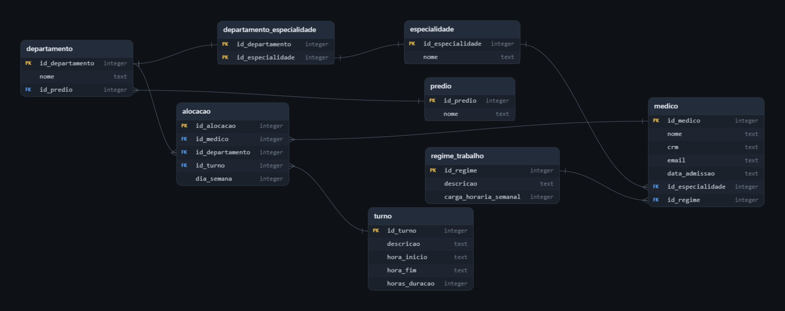

# projeto-escala-medica

Sistema de escala médica hospitalar: modelagem de banco de dados em SQLite (Parte 1) e API REST com Spring Boot e JPA (Parte 2).

> **Disciplina:** Banco de Dados — Prof. Stelvio Barboza
> 
> **Escopo deste repositório no momento:** Parte 1 — modelagem, estrutura do repositório e scripts SQL.

---

## 1. Visão geral

Um hospital fictício opera em vários prédios, cada um com seus departamentos: UTI, pronto atendimento, ambulatórios e centro cirúrgico. Hoje, a escala dos médicos é montada em planilhas e ninguém sabe ao certo onde cada profissional está. A pergunta central que o projeto precisa responder é:

> **Em qual prédio e departamento o médico X está no dia Y, turno Z?**

Já existe um cadastro de médicos em SQLite (`hospital.sqlite`). Este projeto estende esse banco para organizar a escala semanal, permitindo consultar dias, locais, turnos e horários de cada profissional de saúde.

Exemplo do tipo de resposta que o banco deve fornecer:

```
Ana Ribeiro (Ortopedia)
Segunda-feira, turno da manhã
Bloco A - Principal, UTI Adulto
```

## 2. Estrutura do repositório

```
projeto-escala-medica/
├── README.md
├── .gitignore
├── database/
│   ├── base/
│   │   └── hospital.sqlite
│   ├── ddl/
│   │   ├── 01_create_predio.sql
│   │   ├── 02_create_departamento.sql
│   │   ├── 03_create_departamento_especialidade.sql
│   │   ├── 04_create_turno.sql
│   │   └── 05_create_alocacao.sql
│   ├── dml/
│   │   ├── 01_insert_predio.sql
│   │   ├── 02_insert_departamento.sql
│   │   ├── 03_insert_turno.sql
│   │   ├── 04_insert_departamento_especialidade.sql
│   │   └── 05_insert_alocacao.sql
│   └── queries/
│       ├── 01_select_q1.sql
│       ├── 02_select_q2.sql
│       ├── 03_select_q3.sql
│       ├── 04_select_q4.sql
│       ├── 05_select_q5.sql
│       └── 06_select_q6.sql
└── docs/
    └── diagramas/
        └── 02_modelo_logico.png
```


| Pasta | Conteúdo |
|---|---|
| `database/base` | Banco fornecido (`hospital.sqlite`). Os scripts rodam sobre uma **cópia** dele, nunca sobre o original. |
| `database/ddl` | Comandos `CREATE TABLE`, um arquivo por tabela, numerados na ordem de execução. |
| `database/dml` | `INSERT`s de prédios, departamentos, turnos, compatibilidades (departamento × especialidade) e alocações. |
| `database/queries` | As seis consultas obrigatórias, uma por arquivo, com o resultado esperado em cabeçalho comentado. |
| `docs/diagramas` | Diagrama do modelo lógico. |

**Convenções adotadas:** tabelas em `snake_case` e no singular; chave primária no formato `id_<tabela>`; chave estrangeira com o mesmo nome da chave primária referenciada; scripts numerados na ordem de execução; um script por tabela no DDL.

## 3. Modelo de dados

### 3.1 Modelo lógico



### 3.2 Tabelas

O banco fornecido já continha três tabelas, **que não tiveram sua estrutura alterada**:

| Tabela | Descrição | Registros |
|---|---|---|
| `especialidade` | Especialidades médicas (Cardiologia, Pediatria, Ortopedia etc.) | 12 |
| `regime_trabalho` | Regimes e carga horária semanal (20h, 24h, 30h, 36h e 40h) | 5 |
| `medico` | Cadastro dos médicos, com especialidade e regime | 36 |

Foram modeladas cinco novas tabelas, ligadas às anteriores:

| Tabela | Descrição |
|---|---|
| `predio` | Bloco, prédio ou unidade física do hospital. |
| `departamento` | Setor dentro de um prédio, como UTI ou Ambulatório. Um prédio tem vários departamentos. |
| `departamento_especialidade` | Permissões de especialidades por departamento. Tabela associativa de um relacionamento N:N. |
| `turno` | Faixas de horário: manhã (07h às 13h), tarde (13h às 19h) e noite (19h às 07h). |
| `alocacao` | O coração da escala: relaciona médico, departamento, dia da semana e turno. |

### 3.3 Relacionamentos

| Relacionamento | Cardinalidade | Como é implementado |
|---|---|---|
| `regime_trabalho` → `medico` | 1:N | FK `id_regime` em `medico` |
| `especialidade` → `medico` | 1:N | FK `id_especialidade` em `medico` |
| `predio` → `departamento` | 1:N | FK `id_predio` em `departamento` (`NOT NULL`) |
| `departamento` ↔ `especialidade` | N:N | Tabela associativa `departamento_especialidade`, com PK composta pelas duas FKs |
| `medico` → `alocacao` | 1:N | FK `id_medico` em `alocacao` |
| `departamento` → `alocacao` | 1:N | FK `id_departamento` em `alocacao` |
| `turno` → `alocacao` | 1:N | FK `id_turno` em `alocacao` |

Em outras palavras, `alocacao` é a entidade que resolve a relação entre **médico**, **departamento** e **turno** em um determinado **dia da semana**: um médico pode ser alocado em vários departamentos e turnos ao longo da semana, e um departamento recebe vários médicos.

### 3.4 Dados inseridos (DML)

| Tabela | Registros inseridos |
|---|---|
| `predio` | 3 (Bloco A - Principal, Bloco B - Ambulatorial, Bloco C - Emergência) |
| `departamento` | 8 |
| `turno` | 3 (Manhã, Tarde, Noite) |
| `departamento_especialidade` | 17 compatibilidades |
| `alocacao` | 21 alocações, que formam a escala semanal de 10 médicos (os outros 26 ficam sem alocação) |

## 4. Regras de negócio

| Código | Regra | Como é garantida |
|---|---|---|
| RN01 | Um médico não pode ter duas alocações no mesmo dia e turno. | Constraint `UNIQUE (id_medico, dia_semana, id_turno)` em `alocacao` |
| RN02 | Só alocar em departamento que aceita a especialidade do médico. | Consulta de validação (Q4), a ser reforçada na camada de serviço (Parte 2) |
| RN03 | A soma das horas dos turnos alocados não pode passar da carga semanal do regime. | Consulta de validação (Q5), a ser reforçada na camada de serviço (Parte 2) |
| RN04 | Dia da semana de 1 (segunda) a 7 (domingo), padrão ISO 8601. | `CHECK (dia_semana BETWEEN 1 AND 7)` |
| RN05 | Todo departamento pertence a exatamente um prédio. | FK `id_predio` com `NOT NULL` |
| RN06 | Não é possível alocar médico, departamento ou turno inexistente. | FKs em `alocacao` (com `PRAGMA foreign_keys = ON`) |

RN01, RN04, RN05 e RN06 são garantidas pelo próprio banco. RN02 e RN03 dependem de consulta de validação agora e serão implementadas na camada de serviço na Parte 2.

## 5. Como executar

### Pré-requisitos

Qualquer um dos clientes abaixo, com SQLite 3.x:

- [DB Browser for SQLite](https://sqlitebrowser.org/)
- [DBeaver](https://dbeaver.io/)
- Cliente `sqlite3` no terminal

### Importante: chaves estrangeiras no SQLite

O SQLite mantém as chaves estrangeiras **desligadas por padrão**. É necessário executar `PRAGMA foreign_keys = ON;` em **toda conexão**, caso contrário as FKs (e, portanto, a RN06) serão ignoradas.

### Passo a passo (terminal)

> Os comandos abaixo usam sintaxe Bash. No Windows, execute-os no **Git Bash** (não no `cmd`).

1. Clone o repositório e entre na pasta:

   ```bash
   git clone https://github.com/victorlimafla/projeto-escala-medica.git
   cd projeto-escala-medica
   ```

2. Crie uma cópia limpa do banco fornecido (o original em `database/base` não deve ser alterado):

   ```bash
   cp database/base/hospital.sqlite escala_medica.sqlite
   ```

3. Execute os scripts de DDL e depois os de DML, na ordem numérica, ligando as FKs a cada conexão:

   ```bash
   for f in database/ddl/0*.sql database/dml/0*.sql; do
     echo "Executando $f"
     (echo "PRAGMA foreign_keys = ON;"; cat "$f") | sqlite3 escala_medica.sqlite
   done
   ```

4. Confira a integridade das chaves estrangeiras (não deve imprimir nada):

   ```bash
   sqlite3 escala_medica.sqlite "PRAGMA foreign_key_check;"
   ```

5. Execute qualquer consulta, por exemplo a Q1:

   ```bash
   (echo "PRAGMA foreign_keys = ON;"; cat database/queries/01_select_q1.sql) | sqlite3 -header -column escala_medica.sqlite
   ```

   Para rodar as seis de uma vez:

   ```bash
   for f in database/queries/0*.sql; do
     echo "== $f"
     sqlite3 -header -column escala_medica.sqlite < "$f"
   done
   ```

> Se precisar repetir o passo a passo, apague antes a cópia (`rm escala_medica.sqlite`): o DDL não roda duas vezes no mesmo banco.

### Passo a passo (DB Browser ou DBeaver)

1. Abra uma **cópia** de `hospital.sqlite`.
2. Confirme que as chaves estrangeiras estão ativas. No DB Browser, a opção fica em *Edit → Preferences → Database → Foreign keys*. Se o cliente avisar sobre alterar o `PRAGMA` dentro de uma transação, execute `PRAGMA foreign_keys = ON;` sozinho, antes dos scripts.
3. Abra e execute cada script de `database/ddl`, na ordem numérica.
4. Faça o mesmo com os scripts de `database/dml`.
5. Execute as consultas de `database/queries`.

> **Ordem importa.** No DDL: `predio` → `departamento` → `departamento_especialidade` → `turno` → `alocacao`. No DML: `predio` → `departamento` → `turno` → `departamento_especialidade` → `alocacao`. As tabelas sem FK vêm primeiro, e as que dependem delas depois.

## 6. Consultas obrigatórias

Cada consulta está em um arquivo próprio em `database/queries`, com o resultado esperado documentado no comentário do arquivo.

| Arquivo | Descrição | Foco | Resultado esperado |
|---|---|---|---|
| `01_select_q1.sql` | Escala semanal completa de um médico (Ana Ribeiro, `id_medico = 1`): dia, turno, prédio e departamento | Pergunta central | 3 linhas |
| `02_select_q2.sql` | Médicos presentes no Bloco A na quarta-feira à tarde | Pergunta central | 2 linhas (Ana Ribeiro e Gabriela Lacerda) |
| `03_select_q3.sql` | Médicos sem nenhuma alocação na semana | `LEFT JOIN` | 26 linhas (médicos 11 a 36) |
| `04_select_q4.sql` | Alocações em departamento incompatível com a especialidade | Valida RN02 (anti-join) | Vazio (0 linhas) |
| `05_select_q5.sql` | Horas alocadas × carga do regime por médico, indicando quem excedeu | Valida RN03 | 10 linhas, todas com `NÃO` |
| `06_select_q6.sql` | Quantidade de médicos por departamento em cada dia da semana | `GROUP BY` | 17 linhas |

## 7. Decisões de modelagem

- **Chave substituta em `alocacao`.** A tabela usa `id_alocacao` (`INTEGER PRIMARY KEY AUTOINCREMENT`) como PK, e a RN01 é garantida por uma constraint `UNIQUE (id_medico, dia_semana, id_turno)`. Isso facilita o mapeamento para entidade JPA na Parte 2, sem abrir mão da unicidade do negócio.
- **`departamento_especialidade` como tabela associativa.** Um departamento aceita várias especialidades e uma especialidade pode atuar em vários departamentos. A PK composta `(id_departamento, id_especialidade)` impede duplicidade.
- **Dia da semana como inteiro de 1 a 7.** Segue o padrão ISO 8601 (1 = segunda, 7 = domingo) e é protegido por `CHECK`.
- **Horários como `TEXT`.** O SQLite não possui tipos `DATE` e `TIME` nativos. Os horários de `turno` são guardados como texto no formato `HH:MM` (por exemplo, `'07:00'`).
- **`horas_duracao` em `turno`.** A duração é armazenada explicitamente (por exemplo, 6 ou 12), o que simplifica a soma de horas alocadas exigida pela RN03 e evita cálculo de intervalos com horário que atravessa a meia-noite.
- **Turno da noite.** O turno das 19h às 07h cruza a meia-noite. Ele é registrado com `hora_inicio = '19:00'`, `hora_fim = '07:00'` e `horas_duracao = 12`, e a alocação refere-se ao dia em que o turno **começa**.
- **Tabelas existentes preservadas.** `medico`, `especialidade` e `regime_trabalho` não foram modificadas, e as novas tabelas se relacionam com elas por FK.
- **Regras verificadas por consulta.** RN02 e RN03 envolvem comparações entre tabelas que não cabem em uma constraint simples do SQLite. Por isso são validadas pelas consultas Q4 e Q5 e serão reforçadas na camada de serviço na Parte 2.
- **Auditoria por anti-join (Q4).** A consulta Q4 cruza as alocações com `departamento_especialidade` e lista as que não têm compatibilidade correspondente. Com os dados inseridos, ela retorna 0 linhas, o que confirma a RN02 para toda a escala.
- **Q5 com ordem determinística.** O `ORDER BY` inclui `id_medico` como critério final de desempate, para que o resultado seja sempre o mesmo.

## 8. Equipe e próximos passos

**Autores:** [@victorlimafla](https://github.com/victorlimafla) e [@GustavoNakano](https://github.com/GustavoNakano)

**Parte 2 (Backend):**

- Projeto Spring Boot conectado ao banco
- Entidades JPA mapeando as tabelas criadas
- Endpoints para consultar e montar a escala
- RN02 e RN03 implementadas na camada de serviço
